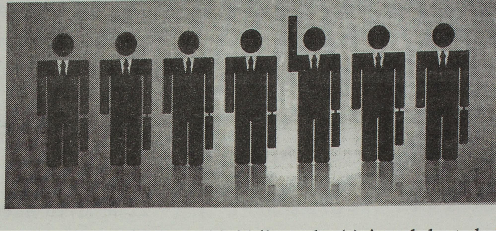

## {{page.title}}



One of the most recent phenomena of the pop culture melting pot are fanzines. A fanzine is something akin to an underground magazine, and there are virtually thousands of them springing up all over the country.

&ldquo;Fanzines cover a wide spectrum of ideas; the articles, interviews and band reviews, however, are not written in a style found in conventional media. The majority of fanzines are put together in a chaotic fashion; poetry, art dabblings, discussions of social and economic repression and articles about non-mainstream bands abound.&rdquo;



In this activity we will study the relationship between image and text. I am including a kind of Fanzine titled "Brujas" (or "Witches", in English), which was published in Argentina, in 1983, after the return of democracy. Its focus is the social condition of women in the society in two areas: sexual violence and labor rights, especially domestic work. 

In addition, I proposed the analysis of Mujer/Fempress, which discusses the feminist movement, the rights and socioeconomic situation of women in Latin America, and two similar documents by Margaret Cuischank, American lesbian feminist writer and academic. 

Students can choose any of these works to select an image with the "IIIF Cropping Tool" and write a brief (100-200 word post) about the relationship between the image and the text that surrounds it. 

<h4>Objectives</h4>

<ul>
  <li>understand the functionality of the "IIIF cropping tool", capturing small pieces of content </li>
  <li>expand our conception of community organizing, the feminist movement in Latin America, and identify fanzine elements</li>
</ul>



<a href="https://digital.library.ucla.edu/catalog?utf8%3D%25E2%259C%2593%26q%3Dbrujas%26search_field%3Dall_fields&amp;sa=D&amp;source=editors&amp;ust=1785257723376350&amp;usg=AOvVaw2ju9-Qy0vFqv9LNwuMnAvj" target="_blank">Brujas "Witches" Fanzine by ATEM &ldquo;25 de noviembre&rdquo; group</a>

<a href="https://digital.library.ucla.edu/catalog?utf8%3D%25E2%259C%2593%26q%3Dmujer%252Ffempress%26search_field%3Dall_fields&amp;sa=D&amp;source=editors&amp;ust=1785257723376658&amp;usg=AOvVaw3skzd7M5--Ti3KzK-VFloT">mujer/fempress</a>  by Instituto Latinoamericano de Estudios Transnacionales

<a href="https://digital.library.ucla.edu/catalog/ark:/21198/zz001bp40r&amp;sa=D&amp;source=editors&amp;ust=1785257723376989&amp;usg=AOvVaw2v8grOkg6CCRQS1zbsmF83">Letters to Contributors by</a>
<a href="https://digital.library.ucla.edu/catalog?f%255Bauthor_sim%255D%255B%255D%3DCruikshank%252C%2BMargaret&amp;sa=D&amp;source=editors&amp;ust=1785257723377127&amp;usg=AOvVaw3UNTKG-9jFYMZlS7YI3Wyn" target="_blank">  Cruikshank, Margaret</a>

<a href="https://digital.library.ucla.edu/catalog/ark:/21198/zz0019tvmk&amp;sa=D&amp;source=editors&amp;ust=1785257723377354&amp;usg=AOvVaw0azg0WXGrb9KcEbv6NGQTz">Fired or not rehired by Cruikshank, Margaret</a>



IIIF Cropping Tool



...If you chose to work with the "Brujas" or "Mujer/fempress" fanzines, take a few minutes to look for the image you want to analyze. Jot down the page number. 
<ol start="1"><li>click on the 
Manifest IIIF  (blue/red)</li><li>On the new window, look for the  page #, and select the address ending in "/default.jpg" 
</li><li>Paste that link into the IIIF Cropping tool  (above) and then "Submit" (red button)</li>
<li>"Zoom" and position the desired portion at the center of the screen</li>
<li>adjust the corners of the box to cut until you isolate the detail</li>
<li>once satisfied with the positioning of the detail, look for the URL address automatically generated in the grey box. You can copy the address by clicking on the icon below it  (it looks like 2 red sheets of paper)</li>
<li>Follow the below instructions to "Share" your cropped image and analysis</li>

</ol>



In this image, you can see how a designer created a skewed world-vision where men constitute the workforce predominantly. Not only that, in this picture one can appreciate a male figure raising his hand, as a symbol of participation. The author in the fanzine argues that this image also portrays only white-collar workers; emphasizes labor/class inequalities in which employees benefit from workers. She also mentions a historical disparity that began to change not long ago, in 1940 (in Argentina). Finally, we can also expand this discussion to other areas, such as family roles, property rights and obligations, and question what we really mean when we talk about the universality of Human Rights. 



<ol>
<li>click on "Reply" at the bottom of the screen, and a text editor will show up so you can write your post </li>
<li>To input the image you&#39;ll analyze, click on the icon  for "images" near the center of the tools bar
  (next to the hyperlink symbol (chain) and the music/video symbol. 
</li><li>In the emerging window "Upload Image", select the URL (given by the IIIF Cropping Tool), and paste it on the blank space "File URL". In a few words descibe your image in Alt Text, then click "Submit"
</li>
<li>Click on the image and use the menu "Image Options" to adjust the size and shape so others can see easily  Publish your image and brief analysis by _________</li>
</ol>



Write your impressions on the images of a classmate. How is it different/similar to yours?

Interact before _________

